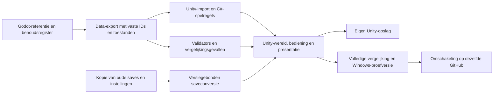

# BlueMap Quest — migratie naar Unity

Status: fases 1 tot en met 6 afgerond op 19 oktober 2026; het volgende go start fase 7.

Eén volgend **go** start één volledige volgende fase, inclusief het noodzakelijke ontwerp, implementatie, eigen hulpmiddelen, controles, bewijs en publicatie op het migratiespoor; daarna volgt een korte rapportage en is het volgende go voor de volgende fase. Een mislukte controle wordt binnen de lopende fase opgelost en telt niet als een afgeronde fase.

Dit wordt het actieve ontwikkelplan en vervangt de oude eerstvolgende ronde als betekenis van een gewoon go. Het bestaande uitbreidingsplan verdwijnt niet: DEVELOPMENT_LIVING_GAME.md blijft bewaard en fase 6, productie en verwerking, wordt hervat na de migratie tenzij sjors anders stuurt. De port voegt eerst dezelfde bestaande game over; toekomstige uitbreidingen worden niet stilzwijgend als al bestaande inhoud meegerekend.

## Uitgangspunt en behoud

- Dezelfde repository: https://github.com/sjorswakka-sketch/bluemap; naam, URL, Git-geschiedenis, bestaande branches, issues, sterren, releases en eventuele website blijven behouden.
- Gecontroleerde huidige referentie: 0.34.0-preview, commit a8a988be27835dec979d2523a3a85a34385eac54, Git-boom 73ba02ea4db0a1c920360b6570f5209ccb970143; fase 1 controleert opnieuw de actuele remote en neemt nieuwer werk volledig mee.
- De schone Godot-bron blijft ongewijzigd op tag godot-baseline-0.34.0 en in de bron- en geschiedenisdownloads van het herstelpunt.
- Referentie-inhoud: 37 kaarten, 19 streken op de atlas, 49.758 tegels, 80 basistegeltypen met varianten, zeven beroepen, 90 kapsels, 24 kledingstukken en 3.187 vertaalde Engelse teksten; overige aantallen volgen uit de daadwerkelijke inventaris in fase 1.
- Alle oorspronkelijke beeld- en audiobestanden, eigen generators, teksten, recepten, soorten, regels, gevonden oplossingen en bestaande bugfixes horen bij het behoudsregister.
- De bestaande 86 Godot-testsuites en native vergelijkingsbeelden blijven als referentie aanwezig; Unity krijgt eigen passende tests die dezelfde gedragsafspraken bewaken.
- Tijdens de port blijft de wereld even ruim en rustig: terrein, paden, bebouwingsruimte en bestaande plaatsingen worden behouden en er worden geen nieuwe gebouwen of willekeurige objecten toegevoegd.
- Godot blijft bruikbaar en downloadbaar totdat Unity de eindcontroles heeft doorstaan; een tijdelijk Actions-artifact is geen permanent herstelarchief, dus fase 1 bewaart ook een duurzaam releasepakket met checksum en herbouwinstructie.

## De fases

1. **Referentie en herstelpunt:** Leg de huidige Godot-versie, Windows-build, volledige inhoud, opgeslagen velden en bestaande tests vast als gecontroleerde referentie die gedurende de hele migratie beschikbaar blijft.

2. **Unity en bouwomgeving:** Controleer Unity, licentie en Windows-modules, kies één ondersteunde editorversie en bewijs met een kleine testbuild dat we lokaal en via een toegestane bouwroute verder kunnen.

3. **Dezelfde GitHub, apart migratiespoor:** Richt binnen dezelfde repository een Unity-migratiebranch met eigen tests en herkenbare downloads in, terwijl de bestaande Claude-branch en Godot-versie bruikbaar blijven.

4. **Spelgegevens en vaste IDs:** Ontwerp een overdraagbaar formaat voor alle spelgegevens, voorwaarden en acties met behoud van bestaande kaart-, object-, item-, quest-, personage- en opslagsleutels.

5. **De volledige wereld exporteren:** Exporteer alle 37 samengestelde kaarten met hun objecten, doorgangen en relevante veranderde toestanden, inclusief toevoegingen die pas tijdens laden of spelen ontstaan.

6. **Eigen graphics, geluid en teksten:** Breng alle oorspronkelijke pixelart, animaties, kapsels, kleding, uitrustingslagen, lettertypen, geluiden, muziek en Nederlandse en Engelse teksten naar Unity over.

7. **De technische spelbasis:** Bouw de Unity-basis voor gebieden, speltoestand, gebeurtenissen, voorwaarden, interacties en speeltijd met één gecontroleerde omzetting van schaal, coördinaten en botsingslagen.

8. **Speler, camera en bediening:** Herstel lopen, direct rennen, stamina, rollen, richten, crosshair, lichaamsrichting, camera en toetsenbord- en controllerinvoer met dezelfde bediening en vrije loopruimte.

9. **Veilige import van saves en instellingen:** Bouw een geteste import van saves, prestaties, Nieuw spel+, taal, geluid en toetsinstellingen naar aparte Unity-opslag zonder de oorspronkelijke Godot-bestanden te overschrijven.

10. **Eerste volledig speelbare proef:** Maak een kleine doorlopende route tussen dorp, woning en bos met interacties, voorwerpen, voortgang en opnieuw laden om de nieuwe basis als geheel te bewijzen.

11. **Alle gebieden en toegangspunten:** Sluit alle 37 gebieden en interieurs aan met herkenbare gebouwen, correcte paden en bruggen, passende ingangsmaten, veilige aankomstpunten, terugroutes en bestaande questsloten.

12. **Voorwerpen, buit en opslag:** Herstel magnetische pickups, kisten, unieke beloningen, inventaris, stapels, thuisopslag, zoeken, sorteren, favorieten en gescheiden meldingen zonder verloren of dubbele spullen.

13. **Ervaring, gear en uiterlijk:** Herstel ervaring, statistieken, alle uitrustingsvakken, wapenniveaus, upgrades, bonussen en persoonlijke haar- en kledingkeuzes met dezelfde zichtbare lagen.

14. **Gevechten, monsters en wild:** Zet wapens, aanvallen, ontwijken, projectielen, vijandgedrag, wilde dieren, gereedschapschecks, schade, herstel en drops over met herkenbare waarschuwingen en animaties.

15. **Gesprekken, quests en gevolgen:** Herstel alle gesprekken, hoofd- en zijopdrachten, voorwaarden, beloningen, verhaalvlaggen en blijvende wereldveranderingen zonder herhaalde beloningen of vastlopende voortgang.

16. **Levendige bewoners:** Zet bewonersroutines, begrensd rondlopen, ontmoetingen, herinneringen, dorpsactiviteiten en avondgasten over zodat bestaande locaties en gebeurtenissen hun karakter behouden.

17. **Beroepen, crafting en handel:** Herstel alle zeven beroepen, vindplaatsen, gereedschappen, recepten, werkplaatsen, winkels, prijzen en materiaalgebruik met dezelfde vereisten en opbrengsten.

18. **Persoonlijk huis en erf:** Breng woning, teleportpunt, meubels, afwerkingen, verlichting, tuinindeling en erfuitbreidingen over met behoud van vrije deuren, looproutes en opgeslagen plaatsingen.

19. **Landbouw en boomgaard:** Herstel grondbewerking, zaden, alle bestaande gewassen, fruitbomen, struiken, mest en fertilizer met dezelfde groeistadia, oogstregels en opbrengsten.

20. **Water en irrigatie:** Zet alle bestaande watertypes, poelen, rivieren, watervallen en aangesloten kanalen over met begrijpelijke waterwerking, correcte bruggen en gemakkelijk oversteekbare irrigatie.

21. **Productie en bijen:** Herstel compost, druiven, wijnvaten, honing, bijen en bloemenvereisten met dezelfde voorraden, verwerkingsregels en berekening op basis van actieve speeltijd.

22. **Bijzondere gebieden en uitdagingen:** Herstel regionale avonturen, moerassluizen, getijden, veerboten, warme bronnen, grotten, puzzels, bazen en arena’s inclusief hun zichtbare gevolgen en beloningen.

23. **Sfeer en presentatie:** Breng bestaande dag- en nachtwisseling, weer, belichting, omgevingsgeluiden, muziek, wateranimaties, stoom en effecten terug met dezelfde rustige en samenhangende uitstraling.

24. **Wereldkaart en complete interfaces:** Werk lokale kaart, wereldatlas, snelreizen en alle beroeps- en spelmenu’s af met NL/EN, duidelijke apparaatwisseling, toetsinstellingen, controllerfocus, rechterstickscrollen en leesbare lijsten.

25. **Volledige voortgang en terugkeer:** Controleer geïmporteerde en nieuwe voortgang tot en met het einde en Nieuw spel+ en bewijs voor bestaande spelinhoud ook een veilige terugexport naar Godot.

26. **Ruimte voor verdere groei:** Meet de Unity-release op vergelijkbare hardware, verbeter aangetoonde knelpunten en beproef grotere gebieden en meer actieve systemen zonder de echte wereld voller te zetten.

27. **Volledige vergelijking en Windows-proefversie:** Controleer alle bestaande spelonderdelen tegen de Godot-referentie en de bedoelingen van de 86 testsuites en lever een complete geteste Unity-Windows-proefversie met lange speelsessies.

28. **Unity als hoofdversie:** Maak na geslaagde eindcontroles met het laatste go Unity de standaard op de Claude-branch binnen dezelfde GitHub en behoud de Godot-bron, build en herstelroute.

## Werkwijze per go

1. Lees dit plan en PROGRESS.json (en lokaal CURRENT_BLUEMAP.md indien aanwezig), controleer de actuele remote en behoud werk dat sinds de vorige fase is toegevoegd.
2. Voer de volgende nog niet afgeronde fase volledig uit; inhoudelijk afhankelijke vervolgfases worden niet alvast als afgerond gemeld.
3. Controleer relevante bestaande functies en hun Unity-tegenhangers, test met tijdelijke aparte opslag en leg meetwaarden, verschillen en beelden vast.
4. Publiceer de geteste fase op de Unity-migratiebranch in dezelfde repository, zonder force-push en met een duidelijke beschrijving van wat al werkt en nog ontbreekt.
5. Werk het behoudsregister en de voortgang bij en meld precies wat is gebouwd, getest, gepubliceerd en wat het volgende go uitvoert.

Het laatste go voor fase 28 is de opdracht voor de concrete omschakeling na de vooraf geteste proefversie; hiervoor komt geen extra algemene bevestigingsronde. Een noodzakelijk Unity-account, aanmelding of passende licentie kan wel een handeling van de gebruiker vereisen en wordt vroeg gecontroleerd in fase 2; er worden geen aankopen gedaan of nieuwe betaalde diensten afgesloten.

## Behoudsregister en voorwaarden voor afronden

Elke bestaande functie krijgt een vaste regel met Godot-bron, bijbehorende IDs, data, regels, referentietoestanden, Unity-implementatie, controles, bewijs en status. De status is niet gestart, in uitvoering of bewezen gelijkwaardig; een ontbrekend onderdeel, lege placeholder of alleen een vergelijkbaar plaatje telt niet als gelijkwaardig. Onbekende objecttypen, acties of velden worden zichtbaar gemeld en mogen niet stilzwijgend verdwijnen.

| Onderdeel | Vereist bewijs |
|---|---|
| Identiteit en content | Volledige sleutelset voor kaarten, objecttypen, items, wapens, vijanden, NPCs, quests, gesprekken, winkels, recepten, beroepen, prestaties, geluiden en teksten zonder onbedoelde ontbrekende of gewijzigde IDs. |
| Werkelijke kaarten | Alle 37 kaarten vergelijken na de volledige samenstelling en relevante runtime-aanpassingen, inclusief terrein, botsingen, spawns, objecten, sloten en terugroutes. |
| Dynamische wereld | Gerichte varianten voor moerasbrug en drooglegging, alle vier getijfasen, geheime doorgangen, bazen, herstel, woning/erf, landbouw en irrigatie, zowel tijdens verandering als na herladen. |
| Gevechten en economie | Dezelfde invoeracties, schaderegels, afkoeltijden, gereedschapseisen, kosten, bonussen, drops, voorraden en unieke beloningen met vastgelegde toleranties waar de physics van beide engines verschillen. |
| Voortgang | Nieuwe, oude, gevorderde, uitgespeelde en NG+-testopslagen met inventaris, gear, geld, quests, geopende kisten, ontdekkingen, huis, erf, landbouw, productie, kaartbezoeken en instellingen. |
| Herhaalbaarheid | Opnieuw importeren, laden, een kist openen of een opdracht voltooien mag geen dubbele beloningen, verdwenen spullen of verloren grondstoffen veroorzaken. |
| Presentatie | Scherpe oorspronkelijke pixelart, vier looprichtingen, juiste voetankers, kloppende kleding- en gearlagen, herkenbare gebouwen, vrije routes en vergelijkingsbeelden in NL/EN op 960×540 en 1152×648. |
| Bediening | Toetsenbord en muis, virtuele controllers via het echte invoersysteem, aangesloten hardware waar beschikbaar, apparaatomschakeling, rebinding, focus, terug/sluiten, lange lijsten en rechterstickscrollen. |
| Atlas en reizen | 19 streken, 37 locaties, huidige binnenlocatie, bezocht/onbevestigd, conservatieve historische import, echte verbindingen en bestaande reisvoorwaarden. |
| Distributie | Versie, opstarten, afsluiten, opslaan, opnieuw starten en volledige Windows-pakketinhoud testen op een schone gebruikersomgeving. |

## Gegevens, coördinaten en saves

De bronwereld is opgebouwd uit oorspronkelijke kaartregels, vele verrijkingen in registry.get_map, aanvullingen en migraties in world.load_map en later veranderende toestand. Een eenmalige export van alleen de oorspronkelijke kaartbestanden of alleen de zichtbare huidige toestand is onvoldoende. Naast basissnapshots worden de regels en acties zelf overgezet en getest op relevante toestanden. De Unity-runtime wordt echt in C# opgebouwd en vereist geen Godot-proces om te spelen; Godot blijft uitsluitend als referentie- en exporthulpmiddel beschikbaar.

Er komt één expliciete schaal- en coördinatenadapter voor Godots pixelcoördinaten en neerwaartse Y-as naar Unity, inclusief tegelmiddens, voetpunten, camera, portaalvlakken, colliders en oude saveposities. De beeldgrootte, het 32px-detailraster en de daadwerkelijke loopruimte blijven de referentie; editorinstellingen, atlasindeling en beeldschaal worden niet op het oog gegokt.

Kisten, unieke pickups en uitbreidingsobjecten gebruiken nu onder meer type:map:objectindex; uitgeschakelde objectslots en oorspronkelijke volgorde mogen bij export niet verschuiven. Altaren gebruiken altaar_<map>_<x>_<y>. Unity krijgt expliciete blijvende legacy-IDs en een volledige vertaaltabel; het opschonen, samenvoegen of sorteren van data mag bestaande voortgang niet aan andere voorwerpen koppelen.

Niet alleen savegame.json telt: meta.cfg, ng_plus.cfg, controls.cfg en settings.cfg bevatten eveneens voortgang en voorkeuren. controls.cfg bevat Godot-invoerobjecten en wordt naar gewone actie- en apparaatbindingen geconverteerd. Oude normalisatie en migraties worden nagebouwd, geteste onbekende velden blijven behouden of geven een duidelijke melding, en import is versiegebonden en herhaalbaar zonder dubbele beloningen.

De originele opslag wordt niet overschreven: import maakt een gevalideerde kopie, schrijft atomair naar een eigen Unity-opslag en maakt herstelkopieën; werkelijke spelersaves worden niet als testbestanden gebruikt of naar GitHub gestuurd. Testprofielen en testopslag zijn gescheiden van de echte game en van beide productieversies.

Landbouw en productie rekenen in de huidige game met actieve speeltijd, niet met een nieuwe onbeperkte offline-inhaalsimulatie; pauze, dagritme, timers en opbrengsten behouden hun regels. Eventuele toekomstige offlinegroei is een aparte uitbreiding.

Een backup garandeert alleen terugkeer naar de voortgang van het backupmoment. Terugkeer met daarna in Unity gemaakte voortgang vraagt een bewezen omgekeerde export voor de overgezette bestaande spelinhoud, die pas in fase 25 als ondersteund wordt gemeld. Later toegevoegde Unity-functies die Godot niet kent vallen buiten die terugexport en mogen niet stilzwijgend worden weggegooid.

## GitHub en bouwbestanden

De voorgestelde migratiebranch is codex/unity-migration binnen de bestaande repository, te maken tijdens uitvoering; de gewone Claude-branch blijft tot fase 28 de bruikbare referentie en main wordt niet ongemerkt vervangen of hernoemd. Een eenvoudig uitgangspunt is een Unity-project in een eigen Unity/-map naast de bestaande Godot-bron, met apart herkenbare builds en workflows; definitieve mappen worden vroeg vastgelegd en oude links, eventuele websitebestanden en buildpaden blijven gecontroleerd behouden.

Assets en hun Unity-.meta-bestanden worden samen bewaard, editor- en pakketversies worden vastgezet, en caches zoals Library, Temp en lokaal gegenereerde builds horen niet in Git. Bestaande Godot-tests en -builds blijven uitvoerbaar via de behouden referentie. Unity krijgt een eigen pakketcontrole: een Unity-Windows-game bestaat doorgaans uit de exe plus Data-map en runtimebestanden, zodat de oude Godot-controle die precies een exe en LEESMIJ verwacht niet blind hergebruikt mag worden.

Een editorinstallatie is aangetroffen op C:/Program Files/Unity/Hub/Editor/6000.3.26f1; aanwezigheid bewijst nog geen werkende licentie, geïnstalleerde Windows-modules of toegestane CI-route. Fase 2 controleert dit vóór veel omzetwerk en legt één ondersteunde versie en bouwroute vast, met lokale gecontroleerde builds als uitgangspunt en geautomatiseerde GitHub-builds waar de beschikbare licentie dat toestaat. Geheimen en licentiebestanden worden niet in de repository gezet.

## Opbouw en samenhang

Gegevens, opgeslagen toestand, spelregels, laden van gebieden, presentatie en invoer krijgen duidelijke grenzen, zodat grotere contentpakketten niet aan willekeurige scripts of objectvolgordes vastzitten. De eerste speelbare proef is een bewijspunt voor die grenzen en geen vervanging voor de ontbrekende rest van het spel.

## Meetbare groei en grenzen

De huidige 86 suites zijn gedragstests en vormen geen bewijs van onbeperkte capaciteit of automatische winst door Unity. Voor prestaties vergelijken we releaseversies onder dezelfde omstandigheden op afgesproken hardware, met beeldtijden en haperingen, geheugen, laadtijden, aantal actieve objecten en opgeslagen gegevens als meetpunten. Grotere stressgebieden worden in een aparte proefomgeving opgebouwd, zodat de werkelijke wereld niet dichter bebouwd hoeft te worden. Alleen gemeten knelpunten rechtvaardigen extra streaming, minder frequente verre simulatie, caches of andere versnelling.

Na de migratie blijven de keuzes voor laden van gebieden, verdere simulatie buiten beeld en ondersteuningsduur van de vastgezette Unity-versie onderwerpen om opnieuw te beoordelen; een overstap belooft op zichzelf geen extra snelheid. Tijdens de omzetting worden nieuwe uitbreidingen beperkt tot technische benodigdheden en concrete reparaties om hetzelfde spel te laten werken.

## Geraadpleegde officiële bronnen

- [Unity releaseondersteuning en versiebeleid](https://unity.com/releases/unity-6/support)
- [Unity editorarchief](https://unity.com/releases/editor/archive)
- [Unity licentieactivatie](https://docs.unity.com/en-us/engine/6000.0/manual/get-started/install-and-upgrade/licenses-and-activation/license-activation-methods)
- [Unity command-line-automatisering](https://docs.unity.com/en-us/engine/6000.3/manual/unity-editor/command-line-arguments/editor)
- [GitHub repositorybeheer](https://docs.github.com/en/repositories)
- [Eventuele GitHub Pages-publicatie](https://docs.github.com/en/pages/getting-started-with-github-pages/configuring-a-publishing-source-for-your-github-pages-site)

De exacte editorpatch, licentie en bouwroute worden bij uitvoering opnieuw gecontroleerd; brononderzoek voor dit plan veranderde de game, echte saves en GitHub niet.
